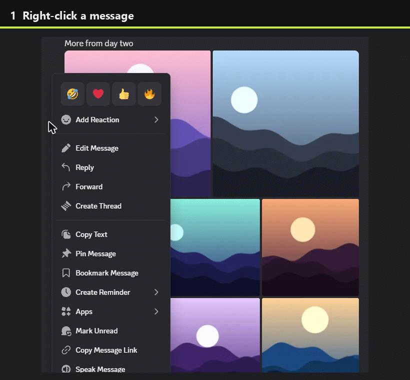

<p align="center">
  
</p>

<h1 align="center">MediaZip</h1>

<p align="center">
  Save every image and video of a Discord message at once, as a ZIP or straight to your device.
  <br>
  <a href="https://mediazip.download">mediazip.download</a> ·
  <a href="https://mediazip.download/install"><b>Add MediaZip to Discord</b></a>
</p>

<p align="center">
  
</p>

---

## How it works

MediaZip is a Discord app that you install to your account. It then works in every server and
DM, including ones where the bot isn't a member.

- **Right-click (or long-press) a message → Apps → Download media.** Only you see the reply.
  It shows thumbnails of the files and two buttons: **Download all** and **Download ZIP**.
  When there are more files than thumbnails (Discord shows up to 10), a **View all** button
  opens the download page without starting a download. A new reply replaces your previous one.
- **Apps → Add to ZIP** collects several messages (up to 10 by default) into one ZIP with a
  folder per message. Your ZIP is kept as a single message in your DM with the bot, and that
  message is updated each time you add something. Its **Download your ZIP** button downloads
  the whole collection.
- **`/zip show`, `/zip link` and `/zip clear`** show, link or empty your ZIP.
- **Forward messages, or upload files, to the bot's DM.** The bot sends one reply with a link
  for all of them.

Each button opens the **download page** on mediazip.download. The page fetches the files from
Discord and then saves them one by one, builds a ZIP in your browser, or offers your device's
share sheet where the browser supports it.

**Scope: images and videos only.** Discord's CDN sends `Access-Control-Allow-Origin: *` for
images and videos, but not for documents, archives and other files. Without that header the
browser can't fetch those files, so they're left out. Self-hosters can opt in to `audio` or
`all` with `MEDIA_TYPES`, but expect the files without CORS headers to fail.

## Privacy and security

- **The server never handles file bytes.** The bot stores Discord's signed CDN URLs. Your
  browser downloads the files directly from `cdn.discordapp.com` / `media.discordapp.net`,
  without cookies or a referrer, and builds the ZIP on your device.
- **Everything is kept in memory only.** The server stores nothing on disk, and a restart
  clears it all. It holds:
  - for each link: your Discord user id, the files' CDN URLs, names and sizes, and the expiry
    time;
  - for your ZIP: the same data per added message, plus the id of the DM message that shows it;
  - for the API rate limiter: the client IP address (or IPv6 /64), with the times of the last
    minute's requests. Up to the 10 000 most recently seen clients are kept.

  On mediazip.download, Cloudflare's proxy sits in front of nginx, which sits in front of the
  app. Cloudflare terminates TLS, so it handles every request and response (not the files,
  which come straight from Discord). nginx keeps no access log.
- **Links expire.** A link lasts 60 minutes by default (`LINK_TTL_MIN`), or less if Discord's
  CDN URLs expire sooner. You can revoke it with the **Revoke** button. Your ZIP expires after
  60 minutes without changes (`BASKET_TTL_MIN`), and its link goes with it.
- **The link token stays out of URLs that reach the server.** It is 256 bits of randomness,
  sent only in replies that only you can see, or in your own DM. The server stores only its
  SHA-256 hash. The token sits in the URL fragment (`/d#…`), which browsers never send to the
  server, so it doesn't appear in access logs. The page sends it to `POST /api/resolve` in the
  request body.
- **A link is a bearer link.** Anyone who has it can download those files until it expires or
  you revoke it.
- **The bot sees very little.** It requests no privileged intents, including Message Content.
  It only reads the messages you run it on, and the messages you send or forward to its DM.
  At the default log level, its own logs record error types, not file names, URLs or
  tokens.
- **There are no analytics, cookies or third-party scripts.** Every page loads only its own
  scripts and styles.
- **The web side is hardened.** It has a strict CSP (`self` only), `Referrer-Policy:
  no-referrer`, and per-IP rate limits on the API. The container runs as a non-root user with a read-only filesystem and all capabilities dropped.

The full policy is at [mediazip.download/privacy](https://mediazip.download/privacy).

## Self-hosting

You need Docker with Compose, a public HTTPS hostname and a Discord application.

### 1. Create the Discord application

1. In the [Developer Portal](https://discord.com/developers/applications), choose
   **New Application**.
2. **General Information:** set the Terms of Service URL to `https://<host>/terms` and the
   Privacy Policy URL to `https://<host>/privacy`.
3. **Bot:** choose **Reset Token** and copy the token into `DISCORD_TOKEN`. Turn *Public Bot*
   on and *Requires OAuth2 Code Grant* off. Leave all three Privileged Gateway Intents off.
4. **Installation:**
   - Installation Contexts: enable both User Install and Guild Install.
   - User Install scopes: `applications.commands`.
   - Guild Install scopes: `applications.commands` and `bot`, with no permissions.
5. Leave *Interactions Endpoint URL* empty, because the bot uses the gateway.

### 2. Configure

```sh
cp .env.example .env
```

| Key | Default | Purpose |
| --- | --- | --- |
| `DISCORD_TOKEN` | required | The bot token |
| `PUBLIC_BASE_URL` | required | The public origin, such as `https://mediazip.download`. It must use https, except for localhost. |
| `DISCORD_APPLICATION_ID` | unset | Used for `/install` before the bot logs in |
| `LINK_TTL_MIN` / `BASKET_TTL_MIN` | `60` / `60` | How long links and ZIPs live |
| `BASKET_MAX_MESSAGES` / `MAX_FILES_PER_LINK` | `10` / `100` | Size limits |
| `MEDIA_TYPES` | `image,video` | Any of `image`, `video` and `audio`, or `all` |
| `BASKET_DM` | `true` | Keep your ZIP as a DM message. With `false`, it appears in reply panels only. |
| `MAX_ACTIVE_LINKS_PER_USER`, `RESOLVE_RATE_PER_MIN`, `DM_DEBOUNCE_SEC` | see `.env.example` | Abuse limits |
| `TRUSTED_PROXIES` | `127.0.0.1` | The peers whose `X-Forwarded-For` header is trusted. Compose adds its network gateway. |
| `HOST_PORT`, `ZIPBOT_SUBNET`, `ZIPBOT_GATEWAY` | `8080`, `172.30.88.0/24`, `.1` | Compose settings: the host port and the network |

[.env.example](.env.example) lists every key. The app refuses to start if a value is invalid
and names the key, without printing its value.

### 3. Run

```sh
docker compose up -d --build
docker compose ps        # shows "healthy" after about 20 seconds
```

The container listens on `127.0.0.1:${HOST_PORT}` only, so put a TLS reverse proxy in front
of it. [deploy/nginx.conf.example](deploy/nginx.conf.example) is a ready-made nginx site. It
includes API rate limiting, and `certbot --nginx` adds HTTPS to it. Behind Cloudflare's proxy,
also include [deploy/cloudflare_realip.conf.example](deploy/cloudflare_realip.conf.example) so
nginx sees the visitor's IP rather than Cloudflare's. Check that `https://<host>/healthz`
returns `{"status": "ok"}`.

The privacy policy ([privacy.html](src/zipbot/web/static/privacy.html)) describes
mediazip.download's own setup (Cloudflare and nginx); adapt it to yours.

To update, run `git pull && docker compose up -d --build`. A restart drops live links and
ZIPs, which are short-lived by design. Run only one instance per bot token.

If the token leaks, choose **Reset Token** in the Developer Portal, update `.env`, and run
`docker compose up -d`.

## Development

Vibecoded with Opus 5.5, but by an experienced programmer following best practices and including
a full test harness.

```sh
python -m venv .venv
.venv/bin/python -m pip install -e ".[dev]"        # on Windows: .venv/Scripts/python
.venv/bin/python -m playwright install chromium firefox webkit
make check                                         # on Windows: powershell -File scripts/check.ps1
```

The gate runs ruff (lint and format), pyright, and pytest with coverage. The tests cover the
unit, handler and web layers, plus Playwright end-to-end tests in Chromium, Firefox and
WebKit. The gate also runs `pip-audit` on `requirements.lock`.

Code layout:

- `src/zipbot/` holds the code:
  - `media.py` extracts the media;
  - `naming.py` names the files;
  - `store.py` holds links and ZIPs;
  - `handlers.py`, `views.py`, `dm_basket.py` and `cogs/` are the Discord side;
  - `web/` is the pages and API.
- `tests/fixtures/` holds scrubbed Discord payloads.
- `tests/contract/` holds the API schema.

## License

[MIT](LICENSE). The vendored [client-zip](https://github.com/Touffy/client-zip) is MIT-licensed; see
[src/zipbot/web/static/VENDOR.md](src/zipbot/web/static/VENDOR.md).
